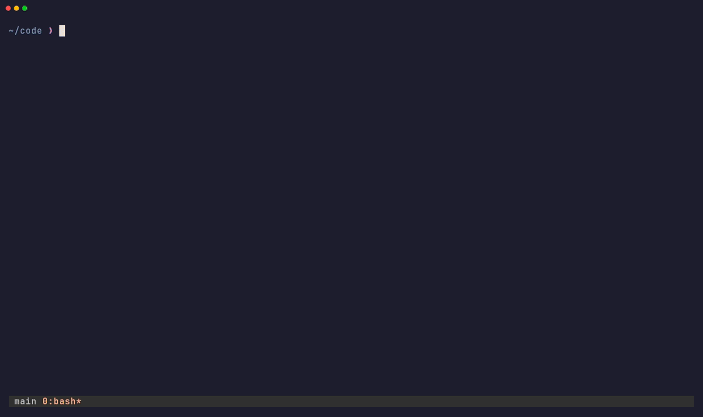

# my-agents (`ma`)

List every coding agent session (`claude code`, `pi`) running on your machine, see which ones are waiting for input, and jump straight to its tmux pane.



## Setup

Requires `tmux`, `jq` and `fzf`. Claude Code agents also need the `claude` CLI on `PATH`, and the branch column needs `git`.

```sh
curl -fsSL --create-dirs https://raw.githubusercontent.com/gaborvecsei/my-agents/main/ma -o ~/.local/bin/ma
chmod +x ~/.local/bin/ma
```

Any directory on your `PATH` works.

## Usage

```sh
ma            # picker: Enter jumps to the agent (if it's in tmux), ctrl-r refreshes
```

Status: `●` waiting for input, `▶` busy, `○` idle, `?` unknown (pi outside tmux). Agents waiting for input are listed first.

## tmux

Open the picker in a popup with `prefix + a`. Add to `~/.tmux.conf`:

```tmux
# Keep the popup open on failure, otherwise the error scrolls past as it closes
bind a display-popup -E -w 90% -h 70% "ma || { printf '[enter] '; read _; }"
```

Use the full path (`~/.local/bin/ma`) if the tmux server doesn't see your `PATH`. Reload with `tmux source ~/.tmux.conf`.

